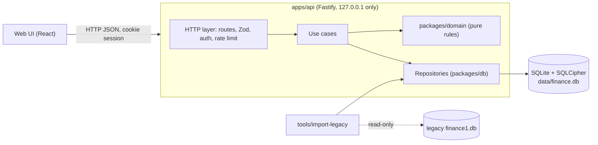

# Architecture

Goal: a **local-first, single-user personal-finance app** that is structured and secure without being over-engineered.
Data lives in one SQLite file on your machine. Nothing leaves it.

## 1. Principles

1. **Ledger is the source of truth.** Balances, net worth and debt are derived, never stored by hand.
2. **Domain logic is pure.** Money rules live in a framework-free package that is trivially unit-testable.
3. **Validate at every boundary** with one shared schema (Zod), used by API and UI.
4. **Secure by default for a local app:** loopback only, authenticated, encrypted at rest, strict headers.
5. **Boring technology.** Few dependencies, each one justified in an ADR.

## 2. Stack (recommended defaults)

| Layer | Choice | Why |
|---|---|---|
| Language | TypeScript (strict) end to end | One language and shared types; strongest hiring signal for full-stack roles |
| Monorepo | pnpm workspaces | Light; no Nx/Turborepo needed yet |
| API | Fastify + `fastify-type-provider-zod` | Fast, schema-first, small surface |
| DB | SQLite via `better-sqlite3` | Synchronous, simple, one file |
| Encryption at rest | SQLCipher build (e.g. `better-sqlite3-multiple-ciphers`) | Protects the file if the laptop is lost; verify package/version when you adopt it |
| Data access | Drizzle ORM + SQL migrations (`drizzle-kit`) | Typed queries, versioned migrations |
| Web | React + Vite + TanStack Query + React Router | Standard, easy to explain in interviews |
| UI | Tailwind + shadcn/ui, Recharts | Fast to build, accessible components |
| Tests | Vitest, `fast-check`, Fastify `inject`, Playwright | Unit, property, API, e2e |
| Quality | ESLint, Prettier, `tsc --noEmit`, Husky + lint-staged | Cheap and expected |
| CI | GitHub Actions (+ Dependabot, CodeQL, gitleaks) | Visible green badge on your profile |

Alternative if you want a real desktop app later: wrap the same web app and API with Tauri. Do **not** start there.

## 3. Repository layout

```text
finance-app/
├─ apps/
│  ├─ api/                 # Fastify server (HTTP adapter, auth, wiring)
│  │  └─ src/{http,auth,infra,main.ts}
│  └─ web/                 # React SPA
├─ packages/
│  ├─ domain/              # Pure TS: Money, Ledger, Debt, Goals, invariants. No I/O.
│  ├─ contracts/           # Zod schemas + inferred types shared by api and web
│  └─ db/                  # Drizzle schema, migrations, repositories, seed
├─ tools/
│  └─ import-legacy/       # Read-only importer for the old finance1.db
├─ docs/
│  ├─ REVERSE_ENGINEERING.md
│  ├─ ARCHITECTURE.md
│  ├─ SECURITY.md
│  └─ adr/0001-....md      # Architecture Decision Records
├─ .claude/                # subagents, skills, settings.json (permissions, hooks)
├─ .github/workflows/ci.yml
├─ CLAUDE.md
├─ .gitignore              # data/, *.db, .env* are ignored from commit #1
└─ README.md
```

Dependency rule: `domain` imports nothing. `db` and `contracts` import `domain`. `api` imports all three. `web` imports `contracts` only.

## 4. Logical view



## 5. Data model (v1 scope)

Keep the legacy concepts, fix the flaws found in `REVERSE_ENGINEERING.md`.

- **Money**: store as `INTEGER` minor units (centavos) in a `*_minor` column. Domain `Money` value object with explicit
  rounding. Never `number` arithmetic on decimals, never floats.
- **`ledger_entries`** (append-only): `id, occurred_on, kind, amount_minor, interest_minor, category_id, source_account_id,
  destination_account_id, goal_id, liability_id, request_id UNIQUE, reverses_entry_id NULL, note, created_at`.
  `kind` is an English enum enforced by `CHECK`. Per-kind invariants (e.g. `expense` needs a source; `transfer` needs two
  different accounts; `debt_payment` principal = amount - interest) are enforced in the domain **and** by `CHECK` where possible.
- **Corrections** are new entries with `reverses_entry_id`, never `UPDATE`/`DELETE` on the ledger.
- **Balances** come from SQL views / domain functions: `account_balance`, `liability_balance`, `net_worth`, `goal_progress`.
- **Master data** (`accounts`, `categories`, `liabilities`, `goals`) use soft delete (`archived_at`).
- **`settings`**: typed columns or one row validated by a Zod schema. No `__finance_type__` marker.
- **`schema_migrations`** handled by drizzle-kit. `PRAGMA foreign_keys = ON` and `journal_mode = WAL` set on every connection
  in one factory function, covered by a test.

Phase 2 tables: `budgets`, `recurring_rules`, `monthly_closings` (generated snapshots), `purchase_scenarios`.

## 6. Security model

Threat model: a single user on a personal machine. Main risks: another local process or a malicious web page calling the
API, theft or loss of the device, leaked data in git, and vulnerable dependencies.

| Risk | Control |
|---|---|
| Other devices on the network reach the API | Bind to `127.0.0.1` only; refuse to start otherwise |
| Malicious web page calls `localhost` (CSRF, DNS rebinding) | Validate `Host` and `Origin` against an allowlist; `SameSite=Strict` cookies; CSRF token on mutations; no permissive CORS |
| Anyone with local access opens the app | Passphrase login; hash with Argon2id; session cookie `HttpOnly`, `Secure` when HTTPS, short idle timeout; login rate limit and lockout |
| Stolen or lost laptop | SQLCipher encryption; key derived from the passphrase (KDF), never stored in the repo or in plain config |
| XSS | React escaping, strict CSP and security headers (`@fastify/helmet`), no `dangerouslySetInnerHTML`, no inline scripts |
| Injection | Parameterized queries only (Drizzle); Zod validation on every request and response |
| Secret or data leaks to GitHub | `.gitignore` for `data/`, `*.db`, `.env*`; gitleaks pre-commit and CI; synthetic seed data only |
| Supply chain | Lockfile, Dependabot, `pnpm audit` in CI, minimal dependencies, pinned versions |
| Data loss | Encrypted backup command (`VACUUM INTO` then encrypt), restore test in CI |
| Sensitive logs | Never log amounts, account names or tokens; structured logs with redaction |

Document these in `docs/SECURITY.md` and a short root `SECURITY.md`. Employers read these.

## 7. Testing strategy

- **Domain (Vitest + fast-check):** property tests such as "sum of all balances == initial balances + net external flows",
  "reversal restores the previous balance", "transfers never change net worth".
- **API:** `fastify.inject` against an in-memory SQLite, including auth, CSRF and Host/Origin rejection.
- **Golden test:** import the legacy DB and assert derived balances and monthly totals match to the cent.
- **E2E (Playwright):** login, add transaction, see balance change, dashboard renders.
- Coverage gate on `packages/domain` (e.g. 90%).

## 8. Delivery plan

| Milestone | Outcome | Done when |
|---|---|---|
| M0 Skeleton | Repo, CI, lint, empty packages, ADR 0001 | CI is green |
| M1 Domain | `Money`, ledger kinds, invariants, balances, property tests | Tests pass, no I/O |
| M2 Persistence | Schema, migrations, repositories, encryption, legacy importer | Golden test passes |
| M3 API + auth | Login, accounts, transactions, idempotency, security tests | Auth and CSRF tests pass |
| M4 UI | Login, accounts, transactions, debts, goals, dashboard | Playwright happy path passes |
| M5 Polish for GitHub | README with screenshots (synthetic data), `SECURITY.md`, release `v0.1.0` | Public repo ready |
| Phase 2 | Budgets, recurring rules, closings, purchase simulator | Per feature |

## 9. Explicit non-goals (to avoid over-engineering)

No microservices, message queues, Kubernetes, GraphQL, multi-tenant auth, cloud sync, or ORM-level event sourcing.
A modular monolith with a clean domain package is enough, and it is easier to defend in an interview.
