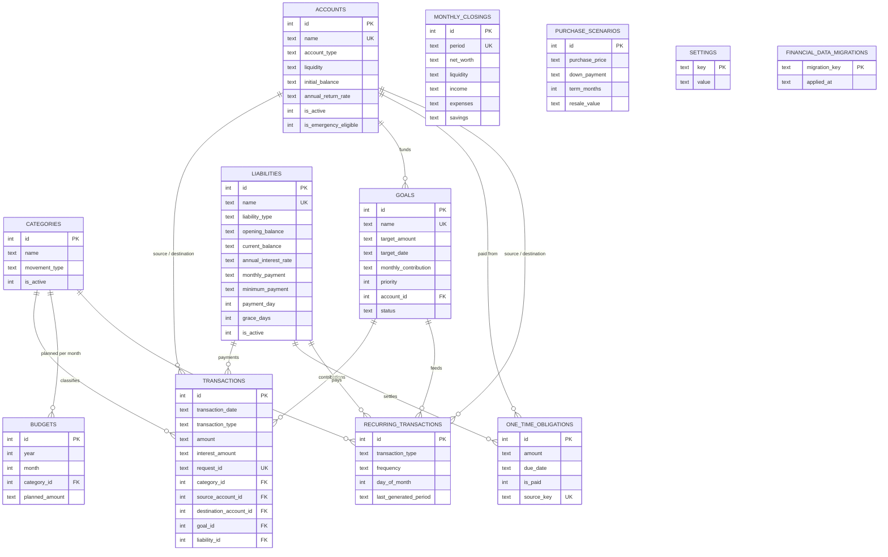

# Reverse engineering of the legacy app

Source: a SQLite file (`user_version = 4`, 12 tables, 11 indexes, `integrity_check = ok`,
no foreign-key violations) produced by a Python, locally deployed personal-finance app.
Locale `es_CO`, currency `COP`.

> This document describes **structure only**. No personal data from the legacy database is included.

## 1. What the app did (inferred from schema + data)

| # | Capability | Evidence in the DB | Used in legacy data? |
|---|---|---|---|
| 1 | Accounts and net worth, grouped by liquidity | `accounts.liquidity`, `annual_return_rate`, `available_date` | Yes |
| 2 | Ledger with 7 transaction types | `transactions.transaction_type` | Yes |
| 3 | Debt management (cards, loans) | `liabilities.*` (payment day, grace days, minimum payment, lender, rate) | Yes |
| 4 | Savings goals | `goals.*` (target, date, monthly contribution, priority, linked account) | Yes |
| 5 | Emergency-fund tracking | `settings`: `emergency_fund_*`, `accounts.is_emergency_eligible` | Yes |
| 6 | One-time obligations (due-date calendar) | `one_time_obligations` | Yes |
| 7 | Recurring transactions | `recurring_transactions` (+ `last_generated_period`) | No (empty) |
| 8 | Monthly budgets per category | `budgets` | No (empty) |
| 9 | Monthly closings (net-worth history snapshots) | `monthly_closings` | No (empty) |
| 10 | Purchase simulator (loan affordability) | `purchase_scenarios`, `settings.purchase_*_limit` | No (empty) |
| 11 | Projections (inflation, income growth, returns) | `settings.annual_inflation`, `annual_income_growth`, `default_annual_return_rate` | Config only |
| 12 | Data repair tooling | `financial_data_migrations` (4 reconcile scripts) | Yes |

Capabilities 7-10 were designed but never fed with data. Treat them as **phase 2**, not as MVP.

## 2. Entity-relationship diagram

## 3. Transaction semantics (the heart of the app)

`transactions` is a single-table, double-entry-flavoured ledger. Which columns are filled depends on `transaction_type`
(verified against the data):

| Type (legacy) | source account | destination account | category | extra link | Meaning |
|---|---|---|---|---|---|
| `ingreso` | - | required | yes | - | Money in |
| `gasto` | required | - | yes | - | Money out |
| `transferencia` | required | required | usually | - | Move between own accounts (source != destination) |
| `ahorro` | required | required | usually | - | Move into a savings account |
| `aporte_meta` | required | - | yes | `goal_id` | Contribution to a goal |
| `pago_deuda` | required | - | yes | `liability_id`, `interest_amount` | Debt payment; principal = `amount - interest_amount` |
| `ajuste_saldo` | one of the two | one of the two | - | - | Manual balance correction (exactly one side is set) |

Other behaviours:

- `request_id` (UUID, `UNIQUE`) is set on every row, so the legacy app **made writes idempotent**.
- Dates are ISO `YYYY-MM-DD`; timestamps are ISO-8601 UTC strings.
- Soft delete via `is_active`; hard deletes are blocked by `ON DELETE RESTRICT`.
- Every FK uses `RESTRICT`, and a `CHECK` prevents `source == destination`.

## 4. Verified findings

1. **Money is stored as decimal strings** (`'1250.00'`, always two decimals, no negatives). Good: no floats.
2. **`liabilities.current_balance` is a cache.** For every liability,
   `current_balance == opening_balance - SUM(amount - interest_amount)` over its `pago_deuda` rows.
   The same fact is stored twice, which explains migrations `001_reconcile_liabilities`, `002`, `003`, `004`.
   *Lesson: never store a value you can derive from the ledger.*
3. **Account balances are not stored**: they are derived (`initial_balance + inflows - outflows`). Good, keep this.
4. **`ajuste_saldo`** exists to patch drift between the ledger and reality. It is a smell: corrections should be
   explicit reversal/correction entries with a reason.
5. **Schema drift**: `liabilities` has six columns appended with `ALTER TABLE` after creation
   (`minimum_payment`, `payment_day`, `grace_days`, `lender`, `payment_schedule_enabled`, `opening_balance`).
   There is no versioned migration framework, only `PRAGMA user_version` plus an ad-hoc `financial_data_migrations` table.
6. **`PRAGMA foreign_keys = 0`** in the file. SQLite does not enforce FKs unless every connection turns them on.
   Today the data is clean (`foreign_key_check` is empty), but nothing in the file guarantees it.
7. **Free-text enums** in Spanish (`'Tarjeta de crédito'`, `'activa'`, `'inmediata'`, `'entre_1_y_6_meses'`) with no `CHECK`.
8. **`settings` stores JSON-in-text** with a magic marker, e.g. `{"__finance_type__":"decimal","value":"5"}`,
   mixed with bare strings such as `"COP"`. Typing is implicit and fragile.
9. **Derived values are persisted in `settings`** (`monthly_income`, `monthly_expenses`, `monthly_savings`):
   same cache problem as finding 2.
10. **Two overlapping vocabularies**: `categories.movement_type` and `transactions.transaction_type` carry the same enum.
11. **No audit trail** and no notion of user/auth (single-user, trusting the local machine).

## 5. What to keep vs. change

| Keep | Change |
|---|---|
| Derived account balances | Derive liability balances too; drop `current_balance` |
| Idempotent writes via `request_id` | Keep, and make it part of the API contract |
| `RESTRICT` FKs + `CHECK` constraints | Turn `foreign_keys=ON` on every connection and test it |
| Decimal-exact money | Use integer minor units (see `ARCHITECTURE.md`) |
| Soft delete for master data | Ledger becomes append-only (corrections via reversal) |
| Typed, explicit transaction kinds | Enforce per-type invariants in the domain layer, not by convention |
| Idea of monthly closings | Make them generated snapshots, never the source of truth |
| - | English enum identifiers + CHECK constraints; Spanish only in the UI |
| - | Versioned SQL migrations instead of `ALTER TABLE` + repair scripts |
| - | Typed settings (one table or validated schema), no magic markers |

## 6. Acceptance test for the rewrite

The new app must be able to **import the legacy file read-only** and reproduce, to the cent, every derived figure:
account balances, liability balances, and monthly income/expense totals. If these match, the domain model is faithful.
